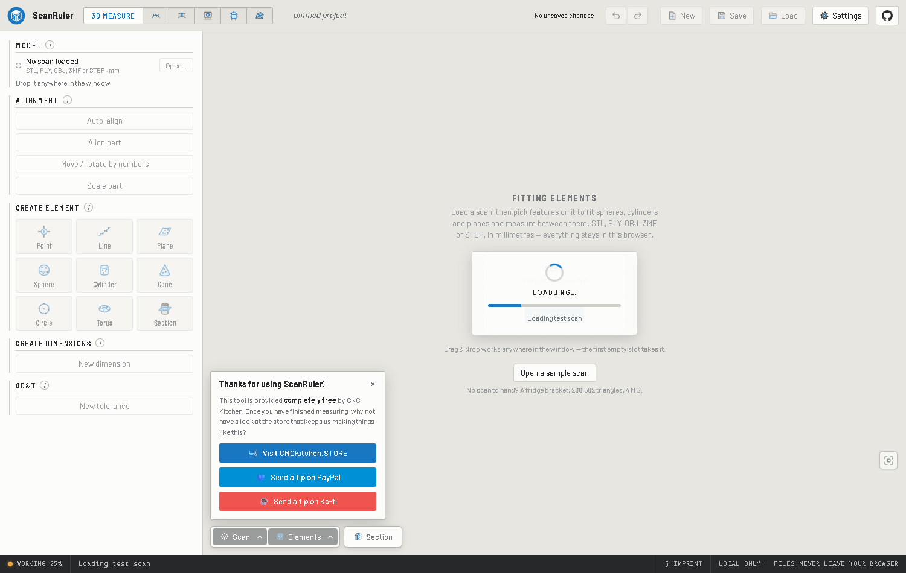

# App-wide activity status

The bottom-left status strip reports tracked work consistently:

- **READY**: no tracked operation is active. This does not certify mesh validity,
  project save status, or an agent connection.
- **WORKING**: a tracked operation is active. The adjacent message names its
  phase. A percentage appears only when the operation reports measured progress.
- **ERROR**: the existing error message takes priority, even if work remains active.

## Using it

1. Open a scan or project, run a fit, alignment, deviation/thickness calculation,
   plugin operation, export, or agent command.
2. Watch the bottom-left lamp and phase text. For measured work it reads, for
   example, `WORKING 25%`. The phase does not repeat that percentage.
3. When work finishes the strip returns to the normal idle status message.
   Concurrent work remains active until its own completion.

The screenshot is a controlled loading-state demonstration, not a benchmark.
Percentages describe the reporting phase, not overall completion or remaining
time. If several activities overlap, the first measured task is shown, otherwise
the first tracked task. Brief tasks may finish before the browser paints.
Existing shortcut help, tool information popups, error messages, element counts,
agent details, and connection/privacy notices are retained.

## Implementation and boundaries

`src/state/taskActivity.ts` owns independently keyed transient tasks. Each owner
clears only its own task. `StatusStrip` combines these with existing core stores,
agent activity, and the plugin registry's busy checks; core never imports plugins.
`WorkerRpc` tracks queued/in-flight requests and measured worker progress.
A request timeout rejects its waiting promise but does not pretend the worker
stopped: activity remains until a late reply or termination. Clone failures,
worker failures, disposal, and completed replies remove the appropriate tasks.
`runExport` tracks export preparation while retaining upstream download/error
behavior and invoking jobs immediately, preserving browser user activation.
Project packing already uses core busy state and worker RPC.

This change reports activity; it does **not** move all synchronous calculations
off the main thread, add cancellation to every tool, or guarantee every operation
emits progress.

## Validation

- `npm test -- --run tests/taskActivity.test.ts tests/workerRpc.test.ts`
- `npm run build`
- `node scripts/check-plugin-boundary.mjs`
- Start an isolated dev server, set `APP_URL`, then run
  `node plugins/mesh-tools/scripts/e2e-app-status.mjs`.

The browser matrix checks reactive core, registered upstream mesh-plugin and
agent states, pending worker activity, idle restoration, stale-percentage
suppression, duplicate-percentage removal, and error priority. These are controlled
state tests, not end-to-end benchmarks of every calculation.
