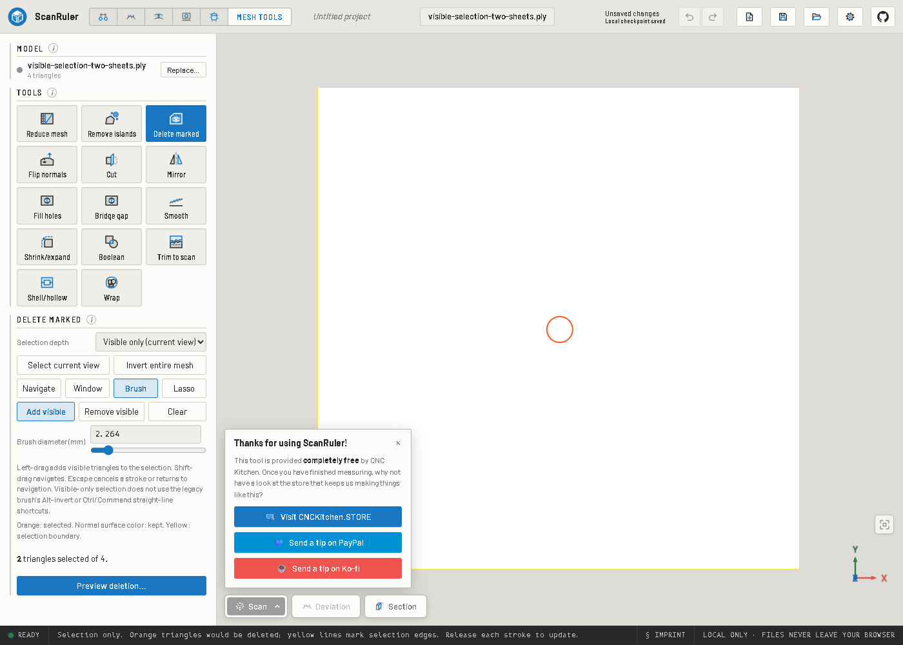

# Visible-only selection update for 0.9.6

This contribution has been merged with upstream 0.9.6 while preserving its bridge,
visible-only deletion, numbered project saves and export workflows. App-wide
status is a separate contribution; this branch reports selection progress in its
own tool panel.

## Why and how

Dense visible-selection calculations previously blocked the UI while building
the visibility BVH, checking triangle-centre rays and sorting boundary edges.
Those phases now use a dedicated cancellable worker with cached mesh geometry
and BVH. Exact frontmost triangle identity is retained, including subpixel
triangles; this is not an approximate depth-tolerance shortcut. Worker results
are rejected after view/mesh changes. Cancellation never publishes a partial
selection.

Visible-only Brush now shares the app's millimetre-based diameter and unit-aware
controls. Its orange Add / teal Remove circle matches the projected view-plane
footprint, scales with zoom, updates while stationary, and disappears off the
viewport or when blocked. It is not the legacy face-oriented ring.

## Instructions

1. Open a copy of your saved project; choose **Mesh Tools > Delete marked**.
2. Keep **Visible only (current view)**. Choose **Add visible** or **Remove
   visible**, then **Select current view**, or refine using Window, Brush or Lasso.
3. Brush diameter follows the chosen display units. Left-drag selects;
   Shift-drag navigates; Escape cancels a stroke or returns to navigation.
   Visible-only mode has no legacy Alt-invert or Ctrl/Command straight-line action.
4. During calculation, read the tool-panel phase/percentage. **Cancel selection**
   preserves the previous selection. Do not expect preview until calculation
   completes; repeat selection if the view changed.
5. Inspect both sides. **Preview deletion**, **Request deletion**, then **Confirm
   removal** are explicit stages. **Keep it** leaves geometry unchanged.
6. **Ctrl+Z** restores the edit. Save a separate editable project revision.

Original coordinates, alignment, exact deletion mapping, explicit confirmation,
undo and project persistence are retained. Bridge edits require this customized
build; missing surface remains inferred, not measured. Initial raster preparation
and final overlay upload remain main-thread work; this is a responsiveness fix,
not a promise of instant selection on every scan.

## Validation

Focused selection/brush/visibility/command tests, production build and plugin
boundary validation were run on this isolated branch. Browser regression:
`node plugins/mesh-tools/scripts/e2e-visible-selection.mjs` against a separate
server/profile. It checks 1,960,000-triangle overlap coverage, subpixel windows,
cancellation, worker-phase heartbeat below 250 ms, exact reordered deletion,
brush visibility/zoom/unit conversion, confirmation, undo and project reload.
The bridge regression is `node plugins/mesh-tools/scripts/e2e-mesh-bridge.mjs`.
Synthetic fixtures are used, not private user scans.

The reported settings loss after reboot is unresolved and not part of this
contribution. No real pairing credentials are included.
